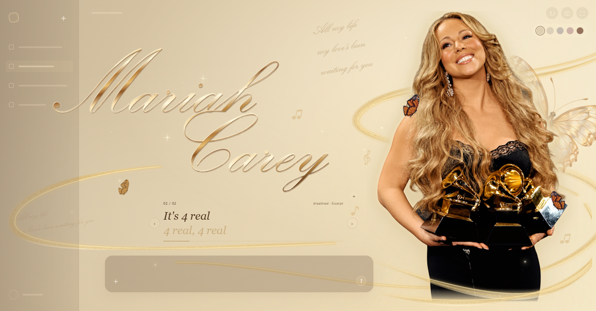

# Mariah Carey wallpaper

**[在线体验 →](https://lambily555.github.io/Mariah-Carey-wallpaper/)**

浅香槟金动态壁纸与独立界面预览，包含人物渐显、金色丝带、蝴蝶扇翅、星光和歌词短句。

## 使用

下载仓库后，用桌面浏览器打开 `index.html`。无需安装依赖。

- **R**：重播入场动画
- **H**：隐藏或显示界面，查看纯壁纸
- **F**：全屏
- 右上角圆点切换配色
- 歌词两侧箭头切换歌曲，小「＋」导入自己持有的 TXT / LRC 文件

滚动区内置《Butterfly》和《4real4real》的简短节选，背景使用《All My Life》的简短节选；不包含完整歌词或音频。导入内容仅保存在当前浏览器。

这是独立网页，尚未集成到 Codex 客户端。已适配系统的减少动态效果设置。

## 素材

人物图片与蝴蝶素材由项目使用者提供，部分装饰图片由 AI 生成。Mariah Carey 的姓名、形象及歌曲等相关权利归各权利人所有；本仓库不授予第三方素材的使用许可。
